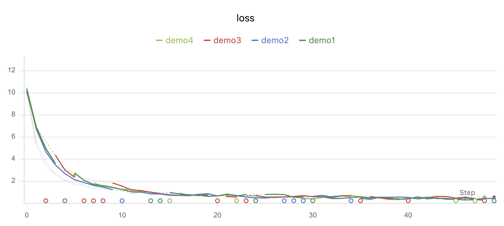
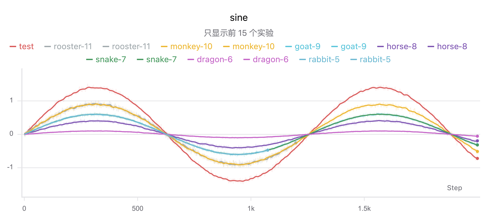

<h1 align="center">smew: A smooth-feathered duck 🦆</h1>

<h3 align="center">一个专为海量折线图打造的高性能平滑工具</h3>

<p align="center">
  <strong>零配置即装即用，WASM 带来 2–12 倍极速，NaN 与 Inf 极端输入稳定运行</strong>
</p>

<p align="center">
  <a href="https://www.npmjs.com/package/smew"></a>
  <a href="https://bundlephobia.com/package/smew"></a>
  <a href="https://github.com/SwanHubX/smew/blob/main/LICENSE"></a>
</p>

<p align="center">
  中文 / <a href="https://github.com/SwanHubX/smew/blob/main/README_EN.md">English</a> / <a href="https://github.com/SwanHubX/smew/blob/main/README_JP.md">日本語</a> / <a href="https://github.com/SwanHubX/smew/blob/main/README_RU.md">Русский</a>
</p>

## 🦆 为什么是 smew？

下面是 SwanLab 图表里的实际效果：



> 浅色为原始数据，实色为平滑结果。TWE：4 组 loss 曲线，参数 `0.2`



> GS：15 条 sine 曲线，参数 `σ = 4`

smew 是 SwanLab 图表正在使用的折线图平滑库，内置 TWE / RA / GS 三种算法。处理机器学习指标、传感器数据或前端图表时，你大概见过这些尴尬：

- ❌ **纯 JS 计算拖慢主线程**：十万点的高斯平滑，单次调用就可能吃掉一整帧，图表交互明显卡顿
- ❌ **引入 WASM 变成工程负担**：要折腾 Vite / Webpack 的静态资源配置，到了 Node / SSR 环境还可能直接报错
- ❌ **缺失值处理不统一**：有的实现把 NaN 当 0 参与计算，有的直接抛异常，结果要么失真、要么中断渲染
- ❌ **极端值把图算坏**：数据里混进异号大数或超大值，平滑时插值上溢成 `Infinity`，曲线断成几截，只能回头去改数据

smew 的解法：

- ⚡ **极速运算**：Rust 编译为 WASM，大数据量下纯计算速度是原生 JS 的 **2–12 倍**
- 🛡️ **自动回退**：自带环境守卫，WASM 不可用或加载失败时切换到 TS 实现，输出一致，**不会抛异常中断业务**
- 📦 **零配置集成**：WASM 字节内联在产物里，安装包压缩后约 **25 kB**，像普通 npm 包一样随装随用，无需打包插件或 CDN 托管
- 🧮 **数值稳定**：常数曲线平滑后与原值全等，输出不会超出已见数据的取值范围，异号大数也不会在插值中上溢
- 🎯 **严格一致性**：算法契约已冻结，NaN 位置确定性传播。两套实现逐位对拍：TWE / RA 位级一致，GS 绝对误差 ≤ 1e-12 或相对误差 ≤ 1e-9

## 📖 目录

- [安装](#-安装)
- [快速上手](#-快速上手)
- [API](#-api)
- [行为契约](#-行为契约)
- [性能](#-性能)
- [边界与不做的事](#-边界与不做的事)
- [参与开发](#-参与开发)
- [协议](#-协议)

## 📥 安装

```bash
npm install smew
```

环境要求：Node.js >= 18，或支持 ESM 与 WebAssembly 的现代浏览器。包只提供 ESM，CommonJS 项目的导入方式见快速上手。

## 🚀 快速上手

统一入口有四个参数，前三个必填：

```ts
smew(type, series, config, checkpoint?)
```

| 参数 | 位置 | 内容 |
| :--- | :--- | :--- |
| `type` | 第一个 | 算法名，取 `'TWE'`、`'RA'` 或 `'GS'` |
| `series` | 第二个 | 原始数据，`{ data: number }` 对象数组，缺失值用 `NaN` 表示 |
| `config` | 第三个 | 配置对象，目前只有 `value` 一个字段，平滑数值放在里面，比如 `{ value: 0.5 }` |
| `checkpoint` | 第四个 | 可选，检查点，见[检查点](#6-检查点让出主线程与取消) |

下面按模块格式分别给出完整示例。

### 1. ESM 项目

直接 `import` 默认导出：

```ts
import smew from 'smew'

const input = [
  { data: 10, index: 0 },
  { data: NaN, index: 1 }, // 该点缺失
  { data: 30, index: 2 }
]

const out = await smew('TWE', input, { value: 0.5 })
// out 与 input 等长、顺序一致
// 返回的 data 为平滑值，其余字段原样保留
```

### 2. CommonJS 项目

包只提供 ESM，`require` 会报错，需要在 async 函数里动态导入：

```js
async function main() {
  const { default: smew } = await import('smew')

  const out = await smew('TWE', [{ data: 10 }, { data: 12 }], { value: 0.5 })
  console.log(out)
}

main()
```

### 3. 输入结构

两种导入方式只有写法不同，下面的用法对两者通用。

输入是泛型对象数组。`data` 以外的字段，比如 `step`、`tag`、`timestamp`，都会原样保留。平滑字段固定为 `data`，业务数据用的是别的字段名时映射一下即可：

```ts
interface Point {
  step: number
  loss: number
  tag: string
}

const points: Point[] = [
  { step: 1, loss: 2.45, tag: 'train' },
  { step: 2, loss: NaN, tag: 'train' },
  { step: 3, loss: 0.82, tag: 'train' }
]

// data 为平滑字段，step、tag 原样返回
const out = await smew(
  'GS',
  points.map((p) => ({ ...p, data: p.loss })),
  { value: 1.5 }
)
```

### 4. 单独调用算法

`smew` 是默认导出。三个算法另有命名导出，装的是同一个包，效果也与统一入口相同：

```ts
import { twe, ra, gs } from 'smew'

const series = [{ data: 10 }, { data: 12 }, { data: 9 }]

await twe(series, 0.5)
await ra(series, 10)
await gs(series, 3)
```
两种导出区别仅在于参数形状：

命名导出已经由函数名确定了算法，因此不用重复说算法名，平滑参数直接作为第二个参数。

而统一入口要先说算法名，平滑参数就落到第三个参数，包在配置对象里：

```ts
smew('TWE', series, { value: 0.5 })
```

### 5. 为什么是异步 API？

WASM 需要异步初始化，因此所有 API 返回 `Promise`。初始化在模块加载时于后台进行，首次调用时若 WASM 尚未就绪，会自动走 TS 实现并返回结果——不会排队等待，也不需要 `await` 一个额外的初始化步骤。

### 6. 检查点：让出主线程与取消

两条路径的调度策略不同：

- **WASM 路径：单次原子计算。** Rust 侧纯计算耗时极短，10 万点约 0.2–6.7 ms，低于一帧。再切片调度只会增加开销，因此不响应检查点。
- **TS 回退路径：逐点可调度。** 无 WASM 环境时纯 JS 遍历可能造成较长任务，检查点用于按点让出主线程、响应取消或上报进度。

传法：统一入口的第四个参数，或命名导出的 `options.checkpoint`，签名为 `(index: number) => void | Promise<void>`，在每个数据点处理前调用并等待。抛出异常会中止计算并向上抛出。

```ts
import smew from 'smew'

const input = [{ data: 10 }, { data: 12 }, { data: 9 }]

// 大数据量下定期让出主线程，仅 TS 回退路径生效
let sliceStart = performance.now()
const out = await smew('TWE', input, { value: 0.5 }, async () => {
  if (performance.now() - sliceStart >= 4) {
    await new Promise((resolve) => setTimeout(resolve))
    sliceStart = performance.now()
  }
})

// 数据已过期时取消
const controller = new AbortController()
const pending = smew('TWE', input, { value: 0.5 }, () => {
  if (controller.signal.aborted) throw new Error('cancelled')
})
controller.abort()
await pending.catch(() => [])
```

WASM 路径下的取消请以业务层放弃结果为准，例如 `Promise.race` 或丢弃返回值。计算本身不会被中断。不传检查点则一次性算完，无任何调度开销。

## 🔌 API

```ts
// 统一入口
smew(type: 'TWE' | 'RA' | 'GS', series, config: { value: number }, checkpoint?): Promise<T[]>

// 命名导出，与统一入口等价
twe(series, value: number, options?): Promise<T[]>
ra(series, value: number, options?): Promise<T[]>
gs(series, value: number, options?): Promise<T[]>
```

- `series`：`{ data: number }` 对象数组，其余业务字段不受限制
- 返回值：与输入等长的数组。每项 `data` 为平滑值，其余字段原样保留
- 原数组不会被修改

`value` 的含义随算法不同：

| 算法 | 含义 | 建议范围 | 调大的效果 | 推荐场景 |
| :--- | :--- | :--- | :--- | :--- |
| `TWE` | 平滑系数 | `0 ~ 0.99` | 新数据权重更高，跟随更快 | 实时流式指标、监控数据 |
| `RA` | 窗口参数，半窗宽为 `floor(value / 2)` | `1 ~ 100` | 窗口更长，曲线更平 | 周期性平稳数据 |
| `GS` | 高斯标准差 `σ` | `1 ~ 100` | 核更宽，平滑更强 | 训练 Loss / Accuracy 曲线等宏观趋势 |

## 📏 行为契约

以下行为已经固定下来，调用方可以依赖。

### 1. 缺失值

- 输入为 `NaN` 的位置，输出保持 `NaN`，不会插值补点
- **TWE**：缺失点不更新递推状态，后续有效点沿用最近一次有效状态
- **RA**：缺失值不参与加权。窗口内无有效数据时输出 `NaN`
- **GS**：缺失值跳过贡献，按剩余有效权重重新归一化

### 2. 数值稳定性

三种算法共用凸组合内核，以下性质可以依赖：

- **常数序列位级透传**：常数线平滑后与原值全等，可用 `===` 判断
- **输出不越界**：结果恒落在已见数据值域内，有限输入必得有限输出
- **极端值防溢出**：异号大数不会在插值中上溢
- **非法权重输出 NaN**：非有限或越界 `[0, 1]` 的权重统一以 `NaN` 表达

已知局限：浮点精度有限。当数据基线极大、单步变化小于基线的可表示精度时，微小变化会被舍入吞掉，曲线可能无法跟随。

### 3. 非法输入

库不信任调用方：任何参数都不会抛异常，而是按冻结规则返回 `NaN` 或原样返回输入。下面三张表只讨论平滑参数的取值，与数据本身无关。

<details>
<summary>TWE — smoothing</summary>

| 参数取值 | 实际行为 |
| :--- | :--- |
| `0` 或 `NaN` | 按 0 处理，权重 0，输出等于输入。缺失点仍为 NaN |
| 负数 | `sqrt(负) = NaN`，权重 NaN，**全部输出 NaN**，首个有效点也不例外 |
| `> 0.99` | `min(sqrt(value), 0.999)` 钳制到 0.999 |

</details>

<details>
<summary>RA — value</summary>

| 参数取值 | 实际行为 |
| :--- | :--- |
| `0`、`1` 或 `(0, 2)` 内小数 | `floor(value / 2) = 0`，窗口仅自身，输出等于输入 |
| `≥ 2` | 正常窗口，长度 `2 × floor(value / 2) + 1`。超过序列长度时钳制为 `w = 序列长度` |
| 负数 或 `NaN` | 循环区间为空，**全部输出 NaN** |
| `±Infinity` | 窗口无效，防御性**全部输出 NaN**，避免宿主挂起 |

</details>

<details>
<summary>GS — sigma</summary>

| 参数取值 | 实际行为 |
| :--- | :--- |
| `0` 或 `NaN` | 中心权重 `exp(0/0) = NaN` 污染整核，**全部输出 NaN** |
| 负数 | 分母 `2σ²` 为正，权重分布同 `\|σ\|`。核大小取 `max(3, floor(负数)) = 3`，即 3 点小核加上 `\|σ\|` 权重 |
| `> 0` | 核大小 `max(3, floor(sigma × 6))`，调整为奇数，权重 `exp(-x² / 2σ²)` 归一化 |

</details>

### 4. 错误处理

非法与边界输入以 `NaN` 输出或原样返回表达，不抛异常、不崩溃。唯一会向上抛出的是调用方自己注入的检查点异常，用于中途取消。

## 📊 性能

基准数据来自 `bench/REPORT.md`。测试环境为 Node 24 / Apple M5，每格 1 亿点规模：

| 场景 | 计时范围 | 加速比 |
| :--- | :--- | :--- |
| 大数据，单次 10 万点 | 纯计算 | TWE 11–12×，RA / GS 2.3–2.8× |
| 大数据，单次 10 万点 | 含数据转换 | 1.9–2.3× |
| 小数据，单次 1 千点，多批次 | 含数据转换 | 最低 1.28×，WASM 始终领先 |

> 纯计算只计时算法本身。含数据转换会算上对象与 `Float64Array` 的拆装，更接近实际使用。

小批量场景单次调用耗时在 10–130 µs 量级，远低于一帧，实际体验差异不明显。WASM 的主要收益在大序列。

## 🚧 边界与不做的事

- 不按相邻 timestamp 间隔调整 TWE 权重
- 不提供引擎切换开关。WASM 不可用时由库自动回退

## 🤝 参与开发

欢迎提 [issue](https://github.com/SwanHubX/smew/issues) 报告问题或讨论需求。构建、测试与审核流程见 [CONTRIBUTING.md](https://github.com/SwanHubX/smew/blob/main/CONTRIBUTING.md)。

## 📄 协议

smew 以 [MIT License](./LICENSE) 开源
