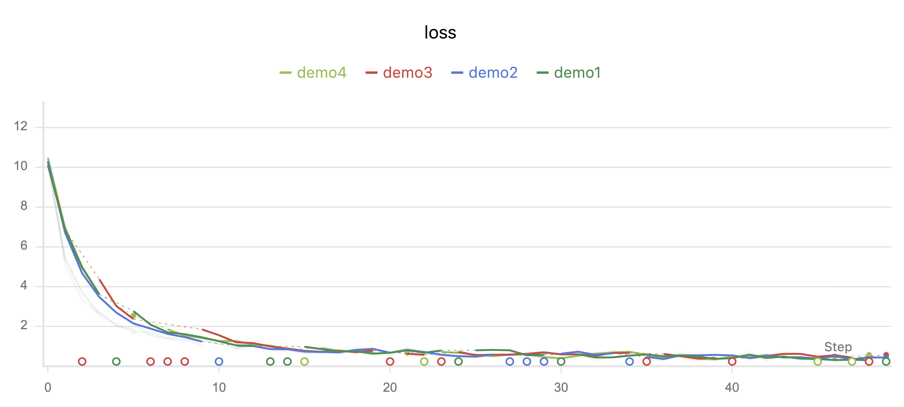
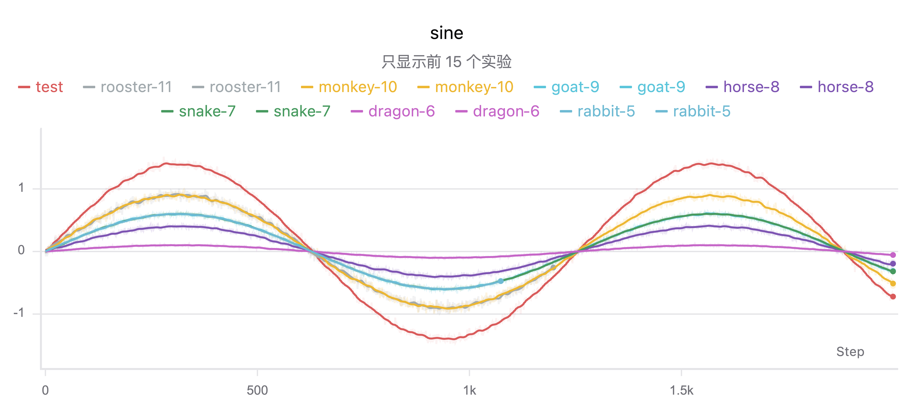

<h1 align="center">smew: A smooth-feathered duck 🦆</h1>

<h3 align="center">A high-performance smoothing tool built for massive line charts</h3>

<p align="center">
  <strong>Zero configuration, 2–12× faster with WASM, stable on NaN and Inf inputs</strong>
</p>

<p align="center">
  <a href="https://www.npmjs.com/package/swanlab-smew"></a>
  <a href="https://bundlephobia.com/package/swanlab-smew"></a>
  <a href="./LICENSE"></a>
</p>

<p align="center">
  <a href="./README.md">中文</a> / English / <a href="./README_JP.md">日本語</a> / <a href="./README_RU.md">Русский</a>
</p>

## Why smew?

Both screenshots come from real SwanLab charts:



> Light lines are raw data, solid lines are the smoothed result. TWE: four loss curves, `value = 0.2`



> GS: fifteen sine curves, `σ = 4`

smew is the line chart smoothing library behind SwanLab charts, with TWE / RA / GS built in. If you plot machine learning metrics, sensor readings or any frontend chart, you have probably run into these:

- ❌ **Pure JS blocks the main thread**: one Gaussian pass over 100k points can eat a whole frame, and the chart stutters while you drag it
- ❌ **Adding WASM turns into build work**: you end up configuring static assets for Vite / Webpack, and Node / SSR environments may fail outright
- ❌ **Missing values handled inconsistently**: some implementations treat NaN as 0, others throw, so the result is either wrong or the render breaks
- ❌ **Extreme values break the chart**: one large value with the opposite sign overflows the interpolation to `Infinity`, the line breaks into pieces, and you go back to editing the data

How smew solves it:

- ⚡ **Fast**: Rust compiled to WASM, **2–12×** faster than plain JS on large series
- 🛡️ **Automatic fallback**: an environment guard switches to the TS implementation when WASM is unavailable or fails to load. Output is identical and nothing throws
- 📦 **Zero configuration**: WASM bytes are inlined in the bundle, the packed tarball is about **25 kB**, installs and runs like any npm package, no bundler plugin or CDN
- 🧮 **Numerically stable**: a constant series comes back bit-for-bit identical, output never leaves the range of the data seen so far, and large values of opposite signs do not overflow the interpolation
- 🎯 **Strict parity**: the algorithm contract is frozen and NaN positions propagate deterministically. Both implementations are diffed bit by bit: TWE / RA are bit-identical, GS matches within an absolute difference of 1e-12 or a relative difference of 1e-9

## Contents

- [Install](#install)
- [Quick start](#quick-start)
- [API](#api)
- [Behavioral contract](#behavioral-contract)
- [Performance](#performance)
- [Boundaries and non-goals](#boundaries-and-non-goals)
- [Contributing](#contributing)
- [License](#license)

## Install

```bash
npm install swanlab-smew
```

Requires Node.js >= 18, or a modern browser with ESM and WebAssembly. The package is ESM-only. For CommonJS projects see the dynamic import in Quick start.

## Quick start

The unified entry point takes four arguments, the first three required:

```ts
smew(type, series, config, checkpoint?)
```

| Argument | Position | Meaning |
| :--- | :--- | :--- |
| `type` | first | Algorithm, one of `'TWE'`, `'RA'`, `'GS'` |
| `series` | second | Raw data, an array of `{ data: number }` objects, `NaN` marks a missing point |
| `config` | third | Config object, only `value` for now, the smoothing parameter |
| `checkpoint` | fourth | Optional, see [checkpoints](#6-checkpoints-yielding-the-main-thread-and-cancellation) |

Complete examples for each module format follow.

### 1. ESM projects

Import the default export directly:

```ts
import smew from 'swanlab-smew'

const input = [
  { data: 10, index: 0 },
  { data: NaN, index: 1 }, // missing
  { data: 30, index: 2 }
]

const out = await smew('TWE', input, { value: 0.5 })
// out has the same length and order as input
// data holds the smoothed value, every other field is preserved
```

### 2. CommonJS projects

The package is ESM-only, so `require` fails. Import it dynamically inside an async function:

```js
async function main() {
  const { default: smew } = await import('smew')

  const out = await smew('TWE', [{ data: 10 }, { data: 12 }], { value: 0.5 })
  console.log(out)
}

main()
```

### 3. Input shape

The two import styles differ only in syntax. Everything below applies to both.

Input is an array of objects. Fields other than `data`, such as `step`, `tag` or `timestamp`, are preserved. The smoothed field is always `data`, so map your own field into it:

```ts
interface Point {
  step: number
  loss: number
  tag: string
}

const points: Point[] = [
  { step: 1, loss: 2.45, tag: 'train' },
  { step: 2, loss: NaN, tag: 'train' },
  { step: 3, loss: 0.82, tag: 'train' }
]

// data is the field being smoothed, step and tag come back unchanged
const out = await smew(
  'GS',
  points.map((p) => ({ ...p, data: p.loss })),
  { value: 1.5 }
)
```

### 4. Calling algorithms directly

`smew` is the default export. Each algorithm also has a named export from the same package and produces the same result:

```ts
import { twe, ra, gs } from 'swanlab-smew'

const series = [{ data: 10 }, { data: 12 }, { data: 9 }]

await twe(series, 0.5)
await ra(series, 10)
await gs(series, 3)
```

The only difference is the parameter shape.

Named exports already know the algorithm from the function name, so the parameter is passed directly as the second argument.

The unified entry point takes the algorithm name first, so the parameter moves to the third argument, wrapped in a config object:

```ts
smew('TWE', series, { value: 0.5 })
```

### 5. Why an async API?

WASM initialization is asynchronous, so every API returns a `Promise`. Initialization starts in the background when the module loads. If WASM is not ready on the first call, the TS implementation runs instead and returns the result. Nothing queues, and there is no extra `await` for setup.

### 6. Checkpoints: yielding the main thread and cancellation

The two paths schedule differently:

- **WASM path: one atomic computation.** The Rust kernel finishes well under a frame, roughly 0.2–6.7 ms for 100k points. Slicing it further only adds overhead, so it ignores checkpoints.
- **TS fallback: schedulable per point.** Without WASM, a plain JS loop can become a long task. Checkpoints let you yield the main thread, react to cancellation or report progress point by point.

Pass it as the fourth argument of the unified entry point, or as `options.checkpoint` on a named export. Signature: `(index: number) => void | Promise<void>`, awaited before each point is processed. Throwing aborts the computation and propagates the error.

```ts
import smew from 'swanlab-smew'

const input = [{ data: 10 }, { data: 12 }, { data: 9 }]

// yield periodically on large series, TS fallback only
let sliceStart = performance.now()
const out = await smew('TWE', input, { value: 0.5 }, async () => {
  if (performance.now() - sliceStart >= 4) {
    await new Promise((resolve) => setTimeout(resolve))
    sliceStart = performance.now()
  }
})

// cancel when the data is stale
const controller = new AbortController()
const pending = smew('TWE', input, { value: 0.5 }, () => {
  if (controller.signal.aborted) throw new Error('cancelled')
})
controller.abort()
await pending.catch(() => [])
```

On the WASM path, cancellation is up to the caller: race the promise or drop the result. The computation itself is not interrupted. Without a checkpoint the whole series is computed in one pass with no scheduling overhead.

## API

```ts
// unified entry point
smew(type: 'TWE' | 'RA' | 'GS', series, config: { value: number }, checkpoint?): Promise<T[]>

// named exports, equivalent
twe(series, value: number, options?): Promise<T[]>
ra(series, value: number, options?): Promise<T[]>
gs(series, value: number, options?): Promise<T[]>
```

- `series`: an array of `{ data: number }` objects, other fields are unconstrained
- Returns an array of the same length. `data` holds the smoothed value, every other field is preserved
- The input array is not modified

`value` differs per algorithm:

| Algorithm | Meaning | Suggested range | Larger value | Typical use |
| :--- | :--- | :--- | :--- | :--- |
| `TWE` | smoothing factor | `0 ~ 0.99` | newer points weigh more, follows faster | real-time metrics, monitoring |
| `RA` | window parameter, half width `floor(value / 2)` | `1 ~ 100` | longer window, flatter curve | periodic, steady data |
| `GS` | Gaussian standard deviation `σ` | `1 ~ 100` | wider kernel, stronger smoothing | loss / accuracy trends |

## Behavioral contract

These behaviors are fixed, and callers can rely on them.

### 1. Missing values

- A position that is `NaN` in the input stays `NaN` in the output, with no interpolation
- **TWE**: a missing point does not update the recurrence, and the next valid point continues from the last valid state
- **RA**: missing values contribute no weight. A window with no valid data outputs `NaN`
- **GS**: missing values are skipped and the remaining weights are renormalized

### 2. Numerical stability

All three algorithms share a convex-combination kernel. These properties hold:

- **Constant series pass through bit-exactly**: a constant line comes back equal to the original, and `===` holds
- **No overshoot**: results stay inside the range of the data seen so far, and finite input always yields finite output
- **No overflow on extremes**: large values of opposite signs do not overflow the interpolation
- **Invalid weights produce NaN**: weights that are non-finite or outside `[0, 1]` are expressed as `NaN`

Known limit: floating point has finite precision. When the baseline is very large and a single step is smaller than the representable precision at that magnitude, the step is rounded away and the curve may not follow.

### 3. Invalid input

The library does not trust its caller: no argument throws. Invalid parameters come back as `NaN`, or the input is returned unchanged, following the fixed rules below. The three tables describe the smoothing parameter only, not the data.

<details>
<summary>TWE — smoothing</summary>

| Value | Actual behavior |
| :--- | :--- |
| `0` or `NaN` | treated as 0, weight 0, output equals input. Missing points stay NaN |
| negative | `sqrt(negative) = NaN`, weight NaN, **everything outputs NaN**, including the first valid point |
| `> 0.99` | `min(sqrt(value), 0.999)`, clamped to 0.999 |

</details>

<details>
<summary>RA — value</summary>

| Value | Actual behavior |
| :--- | :--- |
| `0`, `1`, or a fraction inside `(0, 2)` | `floor(value / 2) = 0`, the window is the point itself, output equals input |
| `≥ 2` | normal window, length `2 × floor(value / 2) + 1`. Clamped to `w = series length` when longer |
| negative or `NaN` | empty loop range, **everything outputs NaN** |
| `±Infinity` | invalid window, defensively **everything outputs NaN**, so the host cannot hang |

</details>

<details>
<summary>GS — sigma</summary>

| Value | Actual behavior |
| :--- | :--- |
| `0` or `NaN` | center weight `exp(0/0) = NaN` poisons the whole kernel, **everything outputs NaN** |
| negative | denominator `2σ²` is positive, weights distribute like `\|σ\|`. Kernel size is `max(3, floor(negative)) = 3`, a 3-point kernel with `\|σ\|` weights |
| `> 0` | kernel size `max(3, floor(sigma × 6))`, adjusted to odd, weights `exp(-x² / 2σ²)` normalized |

</details>

### 4. Error handling

Invalid and boundary inputs are expressed as `NaN` output or returned unchanged. Nothing throws or crashes. The only exception that propagates is the one you throw from your own checkpoint, used to cancel midway.

## Performance

Numbers come from `bench/REPORT.md`. Environment: Node 24 / Apple M5, 100M points per cell:

| Scenario | Timed | Speedup |
| :--- | :--- | :--- |
| Large, 100k points per call | compute only | TWE 11–12×, RA / GS 2.3–2.8× |
| Large, 100k points per call | incl. data conversion | 1.9–2.3× |
| Small, 1k points per call, many batches | incl. data conversion | at least 1.28×, WASM always ahead |

> Compute only times the kernel. Data conversion also counts boxing objects into `Float64Array` and back, which is closer to real usage.

For small batches a call takes 10–130 µs, far below a frame, so the difference is not noticeable. WASM pays off on long series.

## Boundaries and non-goals

- TWE weights are not adjusted by the interval between timestamps
- There is no switch to force an engine. The library falls back on its own when WASM is unavailable

## Contributing

Issues and feature discussions are welcome in [issues](https://github.com/SwanHubX/smew/issues). The build, test and review workflow lives in [CONTRIBUTING.md](https://github.com/SwanHubX/smew/blob/main/CONTRIBUTING.md).

## License

smew is released under the [MIT License](./LICENSE)
