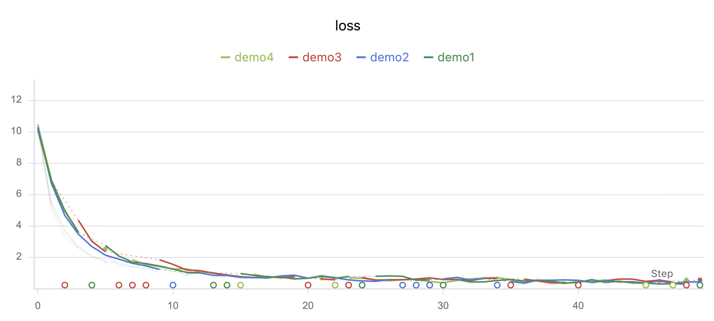
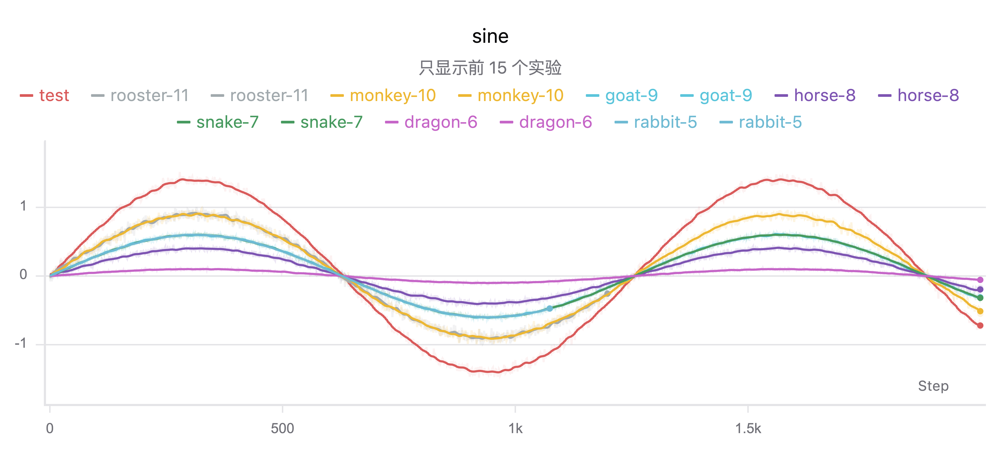

<h1 align="center">smew: A smooth-feathered duck 🦆</h1>

<h3 align="center">大量の折れ線グラフのための高性能スムージングツール</h3>

<p align="center">
  <strong>設定不要ですぐ使え、WASM で 2–12 倍高速、値は範囲を超えず例外も出しません</strong>
</p>

<p align="center">
  <a href="https://www.npmjs.com/package/smew"></a>
  <a href="https://bundlephobia.com/package/smew"></a>
  <a href="./LICENSE"></a>
</p>

<p align="center">
  <a href="./README.md">中文</a> / <a href="./README_EN.md">English</a> / 日本語 / <a href="./README_RU.md">Русский</a>
</p>

## なぜ smew？

薄い線が元データ、濃い線が平滑化した結果です。どちらも SwanLab の実際のグラフです。



> TWE：loss カーブ 4 本、`value = 0.2`



> GS：sine カーブ 5 本、`σ = 4`

smew は SwanLab のグラフで使われている折れ線平滑化ライブラリで、TWE / RA / GS の 3 アルゴリズムを内蔵しています。機械学習の指標、センサーデータ、フロントエンドのグラフを扱っていると、次のような場面に心当たりがあるはずです。

- ❌ **純 JS の計算がメインスレッドを止める**：10 万点のガウス平滑化は 1 回で 1 フレームを使い切り、グラフ操作が目に見えて引っかかる
- ❌ **WASM の導入がビルド作業になる**：Vite / Webpack の静的アセット設定が必要になり、Node / SSR ではそのままエラーになることもある
- ❌ **欠損値の扱いがばらばら**：NaN を 0 として計算する実装もあれば、例外を投げる実装もあり、結果が歪むか描画が止まる
- ❌ **極端な値でグラフが壊れる**：符号の異なる巨大な値が混ざると補間が `Infinity` にオーバーフローし、線が途切れてデータを直しに行くことになる

smew の解決策：

- ⚡ **高速**：Rust を WASM にコンパイルし、大規模データでは計算そのものが JS の **2〜12 倍**
- 🛡️ **自動フォールバック**：環境ガードを内蔵し、WASM が使えない、または読み込みに失敗した場合は TS 実装に切り替えます。出力は同じで、例外で処理を止めません
- 📦 **設定不要**：WASM のバイト列をバンドルに埋め込み、圧縮後は約 **25 kB**。バンドラのプラグインも CDN も不要で、普通の npm パッケージとして使えます
- 🧮 **数値的に安定**：定数列は平滑化後も元の値と完全に一致し、出力は既出データの範囲を出ません。符号の異なる巨大な値でも補間でオーバーフローしません
- 🎯 **厳密な一致**：アルゴリズムの契約は固定され、NaN の位置は決定的に伝播します。2 つの実装はビット単位で突き合わせており、TWE / RA はビット一致、GS は公開された許容誤差の範囲で一致します

## 目次

- [インストール](#インストール)
- [クイックスタート](#クイックスタート)
- [API](#api)
- [動作の契約](#動作の契約)
- [性能](#性能)
- [境界とやらないこと](#境界とやらないこと)
- [開発への参加](#開発への参加)
- [ライセンス](#ライセンス)

## インストール

```bash
npm install smew
```

Node.js >= 18、または ESM と WebAssembly に対応したモダンブラウザが必要です。パッケージは ESM のみです。CommonJS プロジェクトでの読み込み方はクイックスタートを参照してください。

## クイックスタート

統合エントリは引数を 4 つ取り、最初の 3 つは必須です。

```ts
smew(type, series, config, checkpoint?)
```

| 引数 | 位置 | 内容 |
| :--- | :--- | :--- |
| `type` | 1 番目 | アルゴリズム名。`'TWE'`、`'RA'`、`'GS'` のいずれか |
| `series` | 2 番目 | 元データ。`{ data: number }` の配列で、欠損値は `NaN` |
| `config` | 3 番目 | 設定オブジェクト。現在は平滑化パラメータの `value` のみ |
| `checkpoint` | 4 番目 | 任意。[チェックポイント](#6-チェックポイントメインスレッドの譲渡とキャンセル)を参照 |

モジュール形式ごとの完全な例を以下に示します。

### 1. ESM プロジェクト

デフォルトエクスポートを直接 `import` します。

```ts
import smew from 'smew'

const input = [
  { data: 10, index: 0 },
  { data: NaN, index: 1 }, // この点は欠損
  { data: 30, index: 2 }
]

const out = await smew('TWE', input, { value: 0.5 })
// out は input と同じ長さ、同じ順序
// data が平滑化後の値で、それ以外のフィールドはそのまま
```

### 2. CommonJS プロジェクト

ESM のみのため `require` は失敗します。async 関数の中で動的インポートしてください。

```js
async function main() {
  const { default: smew } = await import('smew')

  const out = await smew('TWE', [{ data: 10 }, { data: 12 }], { value: 0.5 })
  console.log(out)
}

main()
```

### 3. 入力の構造

2 つの読み込み方は書き方が違うだけで、以下の使い方はどちらにも当てはまります。

入力はオブジェクトの配列です。`data` 以外のフィールド、たとえば `step`、`tag`、`timestamp` はそのまま返ります。平滑化するフィールドは常に `data` なので、別名を使っている場合は詰め替えてください。

```ts
interface Point {
  step: number
  loss: number
  tag: string
}

const points: Point[] = [
  { step: 1, loss: 2.45, tag: 'train' },
  { step: 2, loss: NaN, tag: 'train' },
  { step: 3, loss: 0.82, tag: 'train' }
]

// data が平滑化対象、step と tag はそのまま返る
const out = await smew(
  'GS',
  points.map((p) => ({ ...p, data: p.loss })),
  { value: 1.5 }
)
```

### 4. アルゴリズムを直接呼ぶ

`smew` はデフォルトエクスポートです。同じパッケージから 3 つのアルゴリズムを名前付きエクスポートとしても取り出せ、結果は統合エントリと同じです。

```ts
import { twe, ra, gs } from 'smew'

const series = [{ data: 10 }, { data: 12 }, { data: 9 }]

await twe(series, 0.5)
await ra(series, 10)
await gs(series, 3)
```

違いは引数の形だけです。

名前付きエクスポートは関数名でアルゴリズムが決まっているため、パラメータを 2 番目の引数に直接渡します。

統合エントリは先にアルゴリズム名を渡すので、パラメータは 3 番目に移り、設定オブジェクトに包まれます。

```ts
smew('TWE', series, { value: 0.5 })
```

### 5. なぜ非同期 API なのか

WASM の初期化が非同期のため、すべての API は `Promise` を返します。初期化はモジュール読み込み時にバックグラウンドで進みます。最初の呼び出しで WASM の準備ができていなければ TS 実装で計算して結果を返します。待ち行列は作らず、追加の `await` も不要です。

### 6. チェックポイント：メインスレッドの譲渡とキャンセル

2 つの経路でスケジューリングの方針が異なります。

- **WASM 経路：1 回の原子的な計算。** Rust 側の計算はごく短く、10 万点で約 0.2〜6.7 ms と 1 フレーム未満です。さらに分割するとオーバーヘッドが増えるだけなので、チェックポイントには反応しません。
- **TS フォールバック経路：1 点ずつスケジュール可能。** WASM がない環境では純 JS の走査が長い処理になり得ます。チェックポイントは 1 点ごとにメインスレッドを譲り、キャンセルに反応し、進捗を報告するために使います。

渡し方は統合エントリの 4 番目の引数、または名前付きエクスポートの `options.checkpoint` です。シグネチャは `(index: number) => void | Promise<void>` で、各点を処理する前に呼び出して待ちます。例外を投げると計算を中止し、そのまま上に伝播します。

```ts
import smew from 'smew'

const input = [{ data: 10 }, { data: 12 }, { data: 9 }]

// 大きな系列では定期的にスレッドを譲る。TS フォールバック経路のみ有効
let sliceStart = performance.now()
const out = await smew('TWE', input, { value: 0.5 }, async () => {
  if (performance.now() - sliceStart >= 4) {
    await new Promise((resolve) => setTimeout(resolve))
    sliceStart = performance.now()
  }
})

// データが古くなったらキャンセル
const controller = new AbortController()
const pending = smew('TWE', input, { value: 0.5 }, () => {
  if (controller.signal.aborted) throw new Error('cancelled')
})
controller.abort()
await pending.catch(() => [])
```

WASM 経路でのキャンセルは、呼び出し側が結果を捨てる形で行ってください。たとえば `Promise.race` を使う、戻り値を無視するなどです。計算自体は中断されません。チェックポイントを渡さなければ一度に計算し、スケジューリングのオーバーヘッドはありません。

## API

```ts
// 統合エントリ
smew(type: 'TWE' | 'RA' | 'GS', series, config: { value: number }, checkpoint?): Promise<T[]>

// 名前付きエクスポート、統合エントリと等価
twe(series, value: number, options?): Promise<T[]>
ra(series, value: number, options?): Promise<T[]>
gs(series, value: number, options?): Promise<T[]>
```

- `series`：`{ data: number }` の配列。その他の業務フィールドは制限なし
- 戻り値：入力と同じ長さの配列。各要素の `data` が平滑化後の値で、それ以外のフィールドはそのまま
- 元の配列は変更されません

`value` の意味はアルゴリズムごとに異なります。

| アルゴリズム | 意味 | 推奨範囲 | 値を大きくすると | 向いている場面 |
| :--- | :--- | :--- | :--- | :--- |
| `TWE` | 平滑化係数 | `0 ~ 0.99` | 新しいデータの重みが増し、追従が速くなる | リアルタイム指標、監視データ |
| `RA` | 窓パラメータ。半窓幅は `floor(value / 2)` | `1 ~ 100` | 窓が長くなり、曲線が滑らかになる | 周期的で安定したデータ |
| `GS` | ガウス標準偏差 `σ` | `1 ~ 100` | カーネルが広がり、平滑化が強くなる | Loss / Accuracy の大局的な傾向 |

## 動作の契約

以下の動作は固定されており、呼び出し側はこれを前提にできます。

### 1. 欠損値

- 入力が `NaN` の位置は出力も `NaN` のまま。補間はしません
- **TWE**：欠損点は再帰状態を更新せず、次の有効な点は直近の有効状態から続きます
- **RA**：欠損値は重みに寄与しません。窓内に有効なデータがなければ `NaN` を出力します
- **GS**：欠損値を飛ばし、残りの有効な重みで再正規化します

### 2. 数値の安定性

3 つのアルゴリズムは凸結合のカーネルを共有しています。次の性質が成り立ちます。

- **定数列はビット単位でそのまま**：定数線は平滑化後も元の値と完全に一致し、`===` で判定できます
- **範囲を出ない**：結果は既出データの値域に収まり、有限の入力からは必ず有限の出力が得られます
- **極端値でもオーバーフローしない**：符号の異なる巨大な値でも補間でオーバーフローしません
- **不正な重みは NaN**：非有限、または `[0, 1]` の範囲外の重みは `NaN` で表します

既知の限界：浮動小数点の精度には限りがあります。基準値が非常に大きく、1 ステップの変化がその桁で表現できる精度より小さい場合、変化は丸めに吸収され、曲線が追従できないことがあります。

### 3. 不正な入力

ライブラリは呼び出し側を信用しません。どの引数でも例外は投げず、固定された規則に従って `NaN` を返すか、入力をそのまま返します。以下の 3 つの表は平滑化パラメータの値だけを扱い、データ自体には触れません。

<details>
<summary>TWE — smoothing</summary>

| パラメータの値 | 実際の動作 |
| :--- | :--- |
| `0` または `NaN` | 0 として扱い、重み 0、出力は入力と同じ。欠損点は NaN のまま |
| 負数 | `sqrt(負) = NaN`、重み NaN、**すべて NaN を出力**。最初の有効点も例外ではない |
| `> 0.99` | `min(sqrt(value), 0.999)` で 0.999 にクランプ |

</details>

<details>
<summary>RA — value</summary>

| パラメータの値 | 実際の動作 |
| :--- | :--- |
| `0`、`1`、または `(0, 2)` の小数 | `floor(value / 2) = 0`、窓はその点のみ、出力は入力と同じ |
| `≥ 2` | 通常の窓。長さは `2 × floor(value / 2) + 1`。系列長を超える場合は `w = 系列長` にクランプ |
| 負数 または `NaN` | ループ範囲が空になり、**すべて NaN を出力** |
| `±Infinity` | 窓が無効。防御的に**すべて NaN を出力**し、ホストの停止を避ける |

</details>

<details>
<summary>GS — sigma</summary>

| パラメータの値 | 実際の動作 |
| :--- | :--- |
| `0` または `NaN` | 中心の重み `exp(0/0) = NaN` がカーネル全体を汚染し、**すべて NaN を出力** |
| 負数 | 分母 `2σ²` は正で、重み分布は `\|σ\|` と同じ。カーネルサイズは `max(3, floor(負数)) = 3`、つまり 3 点の小さなカーネルに `\|σ\|` の重み |
| `> 0` | カーネルサイズ `max(3, floor(sigma × 6))` を奇数に調整し、重み `exp(-x² / 2σ²)` を正規化 |

</details>

### 4. エラー処理

不正な入力や境界の入力は、`NaN` の出力または入力をそのまま返す形で表現します。例外もクラッシュもありません。上に伝播する唯一の例外は、呼び出し側が注入したチェックポイントのもので、途中キャンセルに使います。

## 性能

数値は `bench/REPORT.md` に基づきます。環境は Node 24 / Apple M5、1 セルあたり 1 億点です。

| シナリオ | 計測範囲 | 高速化 |
| :--- | :--- | :--- |
| 大データ、1 回 10 万点 | 計算のみ | TWE 11〜12 倍、RA / GS 2.3〜2.8 倍 |
| 大データ、1 回 10 万点 | データ変換込み | 1.9〜2.3 倍 |
| 小データ、1 回 1 千点、多数バッチ | データ変換込み | 最低 1.28 倍、WASM が常に上回る |

> 計算のみはアルゴリズム本体だけを計測します。データ変換込みではオブジェクトと `Float64Array` の変換も含み、実際の使い方に近くなります。

小さいバッチでは 1 回の呼び出しが 10〜130 µs 程度で、1 フレームよりはるかに短いため、体感差はほとんどありません。WASM の利点は長い系列で効いてきます。

## 境界とやらないこと

- 隣接する timestamp の間隔で TWE の重みを調整しません
- エンジンを切り替えるスイッチは提供しません。WASM が使えないときはライブラリが自動でフォールバックします

## 開発への参加

不具合の報告や要望の議論は [issue](https://github.com/SwanHubX/smew/issues) で歓迎します。ビルド、テスト、レビューの流れは [CONTRIBUTING.md](https://github.com/SwanHubX/smew/blob/main/CONTRIBUTING.md) を参照してください。

## ライセンス

smew は [MIT License](./LICENSE) で公開されています。
