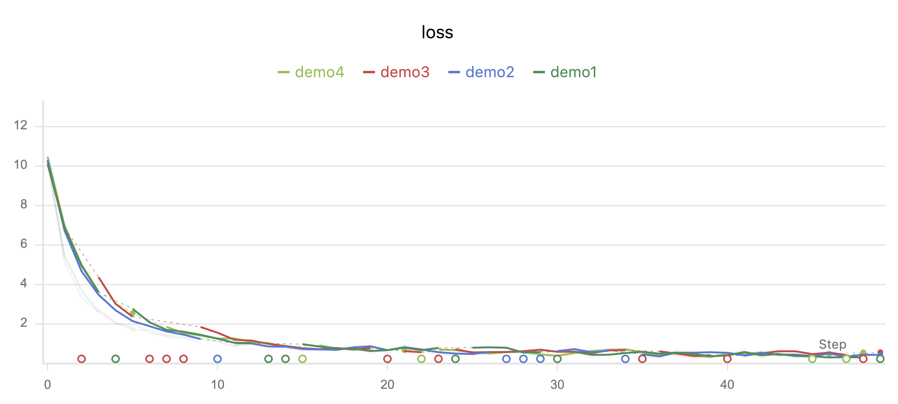
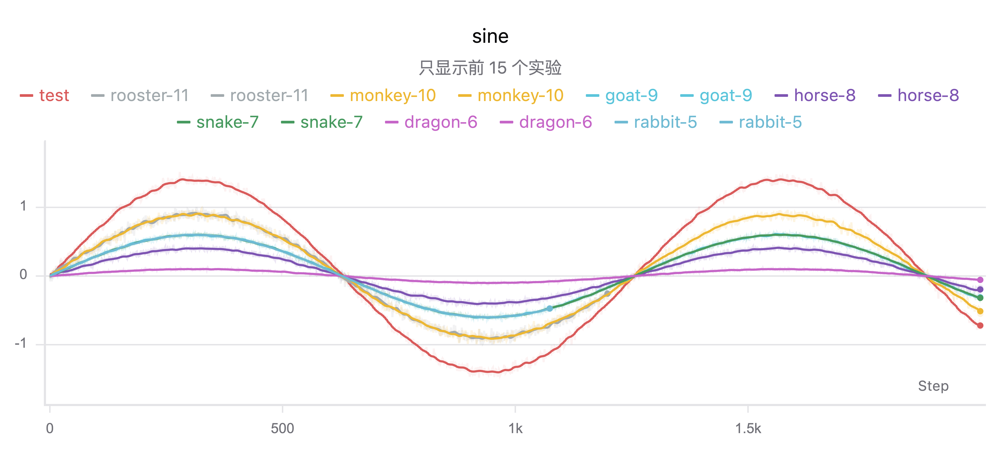

# smew 🦆

**smew: A smooth-feathered duck | 一只羽毛顺滑的鸭子 🦆**

<p align="center">
  <a href="https://www.npmjs.com/package/smew"></a>
  <a href="https://bundlephobia.com/package/smew"></a>
  <a href="./LICENSE"></a>
</p>

<p align="center">
  <a href="./README.md">中文</a> / <a href="./README_EN.md">English</a> / <a href="./README_JP.md">日本語</a> / Русский
</p>

## Почему smew?

Светлые линии это исходные данные, плотные линии это результат сглаживания. Оба скриншота сделаны в реальных графиках SwanLab.



> TWE: 4 кривые loss, `value = 0.2`



> GS: 5 кривых sine, `σ = 4`

smew это библиотека сглаживания линейных графиков, которая работает в графиках SwanLab и содержит три алгоритма TWE, RA и GS. Если вы строите метрики машинного обучения, показания датчиков или любой фронтенд-график, вы наверняка встречали такое:

- ❌ **Чистый JS блокирует главный поток**: один проход гауссова сглаживания по 100 тысячам точек может занять целый кадр, и график заметно подтормаживает при перетаскивании
- ❌ **WASM превращается в работу со сборкой**: приходится настраивать статические ресурсы для Vite / Webpack, а в Node / SSR всё может просто упасть
- ❌ **Пропуски обрабатываются по-разному**: одни реализации считают NaN как 0, другие бросают исключение, в итоге результат либо искажён, либо рендер обрывается
- ❌ **Экстремальные значения ломают график**: одно большое значение с противоположным знаком переполняет интерполяцию до `Infinity`, линия рвётся на куски, и приходится править сами данные

Как это решает smew:

- ⚡ **Быстро**: Rust скомпилирован в WASM, на больших рядах это **2–12×** быстрее обычного JS
- 🛡️ **Автоматический откат**: встроенная проверка окружения переключается на реализацию на TS, если WASM недоступен или не загрузился. Вывод совпадает, ничего не выбрасывает исключение
- 📦 **Без настройки**: байты WASM встроены в бандл, около **25 kB** в сжатом виде, ставится и работает как обычный npm-пакет, без плагинов сборщика и CDN
- 🧮 **Численная устойчивость**: константный ряд возвращается бит в бит, вывод не выходит за диапазон уже увиденных данных, а большие значения разных знаков не переполняют интерполяцию
- 🎯 **Строгое совпадение**: контракт алгоритмов зафиксирован, позиции NaN распространяются детерминированно. Обе реализации сверяются побитово: TWE / RA совпадают бит в бит, GS укладывается в опубликованный допуск

## Содержание

- [Установка](#установка)
- [Быстрый старт](#быстрый-старт)
- [API](#api)
- [Контракт поведения](#контракт-поведения)
- [Производительность](#производительность)
- [Границы и чего нет](#границы-и-чего-нет)
- [Участие в разработке](#участие-в-разработке)
- [Лицензия](#лицензия)

## Установка

```bash
npm install smew
```

Нужен Node.js >= 18 или современный браузер с ESM и WebAssembly. Пакет существует только в формате ESM. Для проектов на CommonJS смотрите динамический импорт в разделе «Быстрый старт».

## Быстрый старт

Единая точка входа принимает четыре аргумента, первые три обязательны:

```ts
smew(type, series, config, checkpoint?)
```

| Аргумент | Позиция | Значение |
| :--- | :--- | :--- |
| `type` | первый | Алгоритм, один из `'TWE'`, `'RA'`, `'GS'` |
| `series` | второй | Исходные данные, массив объектов `{ data: number }`, `NaN` обозначает пропуск |
| `config` | третий | Объект настроек, пока только `value`, параметр сглаживания |
| `checkpoint` | четвёртый | Необязательный, см. [чекпоинты](#6-чекпоинты-уступка-главного-потока-и-отмена) |

Ниже полные примеры для каждого формата модулей.

### 1. Проекты на ESM

Импортируйте экспорт по умолчанию напрямую:

```ts
import smew from 'smew'

const input = [
  { data: 10, index: 0 },
  { data: NaN, index: 1 }, // пропуск
  { data: 30, index: 2 }
]

const out = await smew('TWE', input, { value: 0.5 })
// out совпадает с input по длине и порядку
// в data лежит сглаженное значение, остальные поля сохранены
```

### 2. Проекты на CommonJS

Пакет существует только в формате ESM, поэтому `require` не сработает. Импортируйте динамически внутри асинхронной функции:

```js
async function main() {
  const { default: smew } = await import('smew')

  const out = await smew('TWE', [{ data: 10 }, { data: 12 }], { value: 0.5 })
  console.log(out)
}

main()
```

### 3. Структура входных данных

Два способа импорта отличаются только синтаксисом. Всё описанное ниже относится к обоим.

На вход подаётся массив объектов. Поля кроме `data`, например `step`, `tag` или `timestamp`, сохраняются. Сглаживается всегда поле `data`, поэтому своё поле нужно переложить в него:

```ts
interface Point {
  step: number
  loss: number
  tag: string
}

const points: Point[] = [
  { step: 1, loss: 2.45, tag: 'train' },
  { step: 2, loss: NaN, tag: 'train' },
  { step: 3, loss: 0.82, tag: 'train' }
]

// сглаживается data, step и tag возвращаются без изменений
const out = await smew(
  'GS',
  points.map((p) => ({ ...p, data: p.loss })),
  { value: 1.5 }
)
```

### 4. Прямой вызов алгоритмов

`smew` это экспорт по умолчанию. Каждый алгоритм также доступен как именованный экспорт из того же пакета и даёт тот же результат:

```ts
import { twe, ra, gs } from 'smew'

const series = [{ data: 10 }, { data: 12 }, { data: 9 }]

await twe(series, 0.5)
await ra(series, 10)
await gs(series, 3)
```

Разница только в форме параметров.

Именованные экспорты уже знают алгоритм по имени функции, поэтому параметр передаётся вторым аргументом напрямую.

Единая точка входа принимает имя алгоритма первым, поэтому параметр переезжает в третий аргумент и оборачивается в объект настроек:

```ts
smew('TWE', series, { value: 0.5 })
```

### 5. Почему API асинхронный?

Инициализация WASM асинхронна, поэтому все API возвращают `Promise`. Инициализация стартует в фоне при загрузке модуля. Если на первом вызове WASM ещё не готов, вместо него выполняется реализация на TS и сразу возвращает результат. Ничего не встаёт в очередь, отдельный `await` для подготовки не нужен.

### 6. Чекпоинты: уступка главного потока и отмена

Два пути планируют работу по-разному:

- **Путь WASM: одно атомарное вычисление.** Ядро на Rust укладывается заметно меньше кадра, примерно 0.2–6.7 мс на 100 тысяч точек. Дробить его дальше значит только добавлять накладные расходы, поэтому чекпоинты игнорируются.
- **Путь TS: планирование по точкам.** Без WASM обычный цикл на JS может стать длинной задачей. Чекпоинты позволяют уступать главный поток, реагировать на отмену и сообщать прогресс по точкам.

Передавайте его четвёртым аргументом единой точки входа или как `options.checkpoint` у именованного экспорта. Сигнатура `(index: number) => void | Promise<void>`, вызывается перед обработкой каждой точки и ожидается. Выброшенное исключение прерывает вычисление и пробрасывается наружу.

```ts
import smew from 'smew'

const input = [{ data: 10 }, { data: 12 }, { data: 9 }]

// на больших рядах уступаем поток периодически, только для пути TS
let sliceStart = performance.now()
const out = await smew('TWE', input, { value: 0.5 }, async () => {
  if (performance.now() - sliceStart >= 4) {
    await new Promise((resolve) => setTimeout(resolve))
    sliceStart = performance.now()
  }
})

// отменяем, когда данные устарели
const controller = new AbortController()
const pending = smew('TWE', input, { value: 0.5 }, () => {
  if (controller.signal.aborted) throw new Error('cancelled')
})
controller.abort()
await pending.catch(() => [])
```

На пути WASM отмена остаётся за вызывающей стороной: гоняйте промис наперегонки или просто отбрасывайте результат. Само вычисление не прерывается. Без чекпоинта весь ряд считается за один проход без накладных расходов на планирование.

## API

```ts
// единая точка входа
smew(type: 'TWE' | 'RA' | 'GS', series, config: { value: number }, checkpoint?): Promise<T[]>

// именованные экспорты, эквивалентны
twe(series, value: number, options?): Promise<T[]>
ra(series, value: number, options?): Promise<T[]>
gs(series, value: number, options?): Promise<T[]>
```

- `series`: массив объектов `{ data: number }`, остальные поля не ограничены
- Возвращается массив той же длины. В `data` лежит сглаженное значение, все остальные поля сохранены
- Исходный массив не изменяется

`value` означает разное для каждого алгоритма:

| Алгоритм | Значение | Рекомендуемый диапазон | Больше значение | Типичное применение |
| :--- | :--- | :--- | :--- | :--- |
| `TWE` | коэффициент сглаживания | `0 ~ 0.99` | новые точки весят больше, кривая быстрее следует за данными | метрики в реальном времени, мониторинг |
| `RA` | параметр окна, полуширина `floor(value / 2)` | `1 ~ 100` | окно длиннее, кривая ровнее | периодические стабильные данные |
| `GS` | стандартное отклонение Гаусса `σ` | `1 ~ 100` | ядро шире, сглаживание сильнее | общие тренды loss / accuracy |

## Контракт поведения

Эти правила зафиксированы, и вызывающая сторона может на них опираться.

### 1. Пропуски

- Позиция, где на входе `NaN`, остаётся `NaN` и на выходе, без интерполяции
- **TWE**: пропуск не обновляет состояние рекурсии, и следующая валидная точка продолжает от последнего валидного состояния
- **RA**: пропуски не дают вклада в вес. Если в окне нет валидных данных, на выходе `NaN`
- **GS**: пропуски отбрасываются, оставшиеся веса нормализуются заново

### 2. Численная устойчивость

Все три алгоритма используют одно ядро на основе выпуклой комбинации. Выполняются такие свойства:

- **Константный ряд проходит бит в бит**: константная линия возвращается равной исходной, проверка через `===` проходит
- **Без перелёта**: результат остаётся внутри диапазона уже увиденных данных, конечный вход всегда даёт конечный выход
- **Без переполнения на экстремумах**: большие значения разных знаков не переполняют интерполяцию
- **Некорректные веса дают NaN**: веса, которые не конечны или выходят за `[0, 1]`, выражаются как `NaN`

Известное ограничение: у чисел с плавающей точкой конечная точность. Если базовая величина очень велика, а один шаг меньше представимой точности на этом порядке, шаг округляется и кривая может не отследить изменение.

### 3. Некорректные входные данные

Библиотека не доверяет вызывающей стороне: ни один аргумент не приводит к исключению. Некорректные параметры возвращаются как `NaN` либо вход возвращается без изменений, по зафиксированным ниже правилам. Три таблицы описывают только параметр сглаживания, а не сами данные.

<details>
<summary>TWE — smoothing</summary>

| Значение | Фактическое поведение |
| :--- | :--- |
| `0` или `NaN` | считается 0, вес 0, выход равен входу. Пропуски остаются NaN |
| отрицательное | `sqrt(отрицательного) = NaN`, вес NaN, **на выходе всё NaN**, включая первую валидную точку |
| `> 0.99` | `min(sqrt(value), 0.999)`, ограничивается значением 0.999 |

</details>

<details>
<summary>RA — value</summary>

| Значение | Фактическое поведение |
| :--- | :--- |
| `0`, `1` или дробь в `(0, 2)` | `floor(value / 2) = 0`, окно это сама точка, выход равен входу |
| `≥ 2` | обычное окно длиной `2 × floor(value / 2) + 1`. Если длина больше ряда, ограничивается `w = длина ряда` |
| отрицательное или `NaN` | диапазон цикла пуст, **на выходе всё NaN** |
| `±Infinity` | некорректное окно, защитно **на выходе всё NaN**, чтобы хост не завис |

</details>

<details>
<summary>GS — sigma</summary>

| Значение | Фактическое поведение |
| :--- | :--- |
| `0` или `NaN` | вес центра `exp(0/0) = NaN` отравляет всё ядро, **на выходе всё NaN** |
| отрицательное | знаменатель `2σ²` положителен, веса распределяются как `\|σ\|`. Размер ядра `max(3, floor(отрицательного)) = 3`, ядро из 3 точек с весами `\|σ\|` |
| `> 0` | размер ядра `max(3, floor(sigma × 6))`, приводится к нечётному, веса `exp(-x² / 2σ²)` нормализуются |

</details>

### 4. Обработка ошибок

Некорректные и граничные входные данные выражаются выходом `NaN` или неизменённым входом. Ничего не выбрасывает исключение и не падает. Единственное исключение, которое проходит наружу, это ваше собственное из чекпоинта, с помощью которого вы отменяете вычисление на середине.

## Производительность

Числа взяты из `bench/REPORT.md`. Окружение: Node 24 / Apple M5, по 100 млн точек на ячейку:

| Сценарий | Что измеряется | Ускорение |
| :--- | :--- | :--- |
| Большие данные, 100 тыс. точек за вызов | только вычисление | TWE 11–12×, RA / GS 2.3–2.8× |
| Большие данные, 100 тыс. точек за вызов | включая преобразование данных | 1.9–2.3× |
| Малые данные, 1 тыс. точек за вызов, много пакетов | включая преобразование данных | минимум 1.28×, WASM всегда впереди |

> «Только вычисление» замеряет ядро алгоритма. «Включая преобразование данных» дополнительно считает упаковку объектов в `Float64Array` и обратно, что ближе к реальному использованию.

На малых пакетах один вызов занимает 10–130 µs, это заметно меньше кадра, поэтому разница не ощущается. WASM выигрывает на длинных рядах.

## Границы и чего нет

- Веса TWE не корректируются по интервалу между timestamp
- Нет переключателя, чтобы принудительно выбрать движок. Если WASM недоступен, библиотека откатывается сама

## Участие в разработке

Issues и обсуждение идей приветствуются в [issues](https://github.com/SwanHubX/smew/issues). Сборка, тесты и порядок ревью описаны в [CONTRIBUTING.md](https://github.com/SwanHubX/smew/blob/main/CONTRIBUTING.md).

## Лицензия

smew распространяется по [MIT License](./LICENSE)
